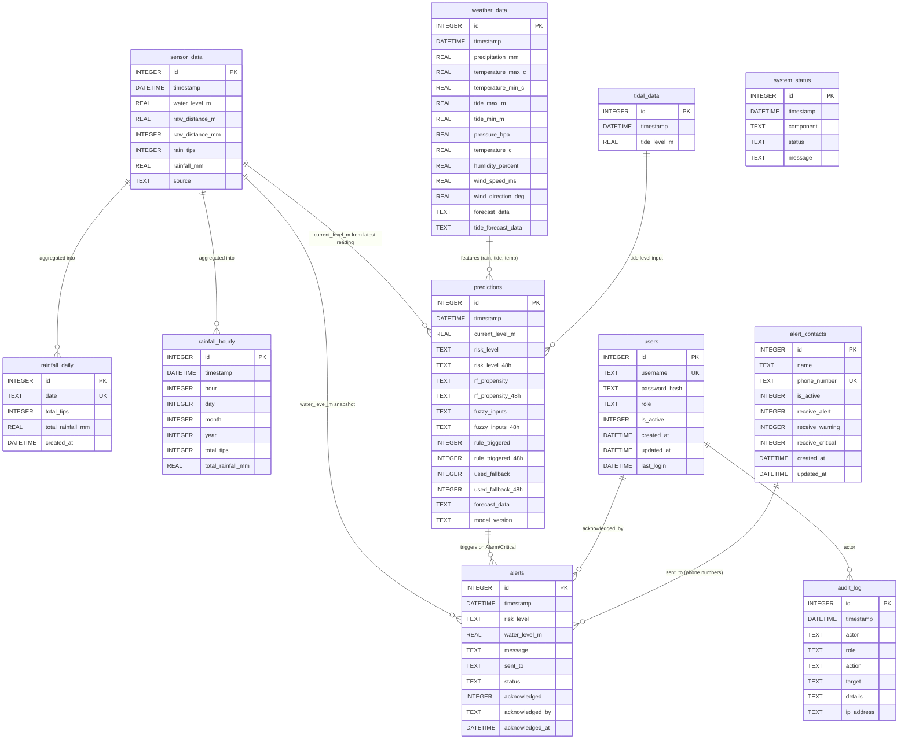

# Database ERD — River Monitor

SQLite database (`data/river_monitor.db`). No foreign-key constraints are declared; relationships below are logical (derived from how the application joins/uses the tables).

## Table groups
- **Sensor/ingestion**: `sensor_data`, `tidal_data`, `rainfall_hourly`, `rainfall_daily`
- **Weather**: `weather_data`
- **AI output**: `predictions`
- **Alerting**: `alerts`, `alert_contacts`
- **Auth/audit**: `users`, `audit_log`
- **Ops**: `system_status`
