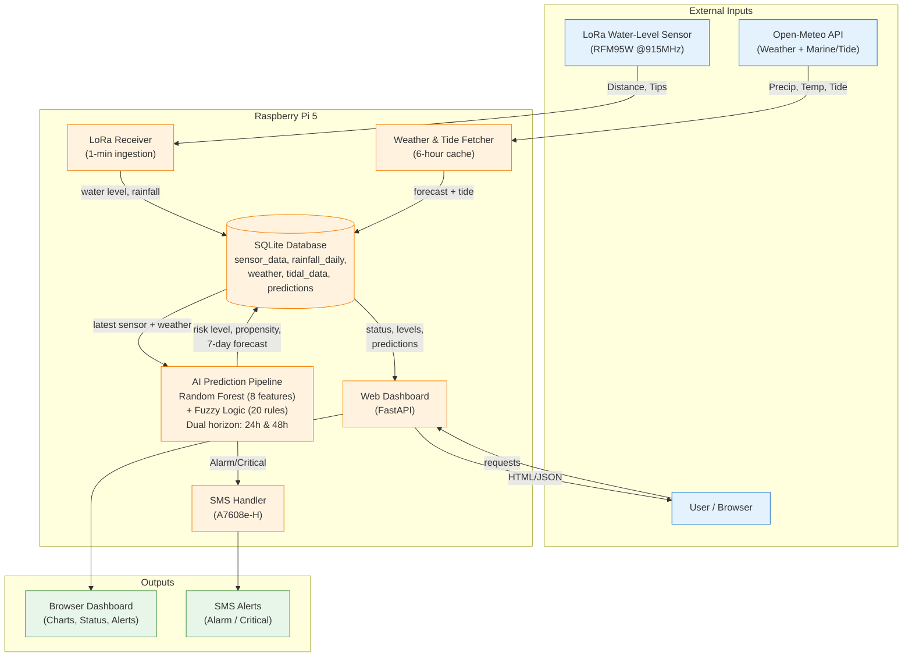

# System Flowchart — River Monitor

## How to read
- **Inputs**: LoRa sensor (water level every minute), Open-Meteo API (weather/tide every 6 h), user via browser.
- **Processing (Raspberry Pi 5)**: LoRa receiver ingests data; weather fetcher caches forecasts; both persist to SQLite; AI pipeline runs RF + fuzzy logic for 24 h and 48 h horizons; web dashboard serves the UI; SMS handler sends alerts on Alarm/Critical.
- **Outputs**: Browser dashboard for monitoring; SMS alerts to configured phone numbers.
